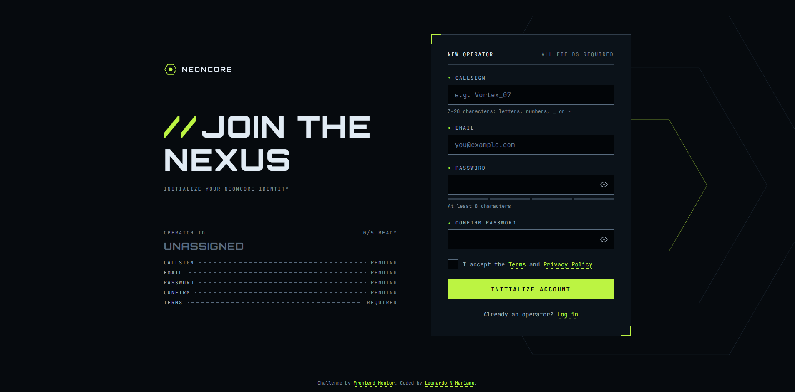

# Frontend Mentor - Gamer sign-up form solution

This is a solution to the [Gamer sign-up form challenge on Frontend Mentor](https://www.frontendmentor.io/challenges/gamer-sign-up-form). Frontend Mentor challenges help you improve your coding skills by building realistic projects. 

## Table of contents

- [Overview](#overview)
  - [The challenge](#the-challenge)
  - [Screenshot](#screenshot)
  - [Links](#links)
- [My process](#my-process)
  - [Built with](#built-with)
  - [What I learned](#what-i-learned)
  - [Continued development](#continued-development)
  - [Useful resources](#useful-resources)
  - [AI Collaboration](#ai-collaboration)
- [Author](#author)

## Overview

### The challenge

Users should be able to:

- Fill in the form with a callsign, email, password, and password confirmation, and accept the terms
- Receive form validation messages if any field is missed or filled in incorrectly
- Show and hide each password with the eye button
- See a password strength meter update as they type
- See a loading state on the button while the form submits, then a success message
- Complete the form only using their keyboard
- Have inputs, hints, error messages, and the success message announced on their screen reader
- View the optimal layout for the interface depending on their device's screen size
- See hover and focus states for all interactive elements on the page

### Screenshot



### Links

- Solution URL: [Frontend Mentor solution](https://www.frontendmentor.io/solutions/gamer-sign-up-form-with-accessible-validation-in-vanilla-js-tFeLp1YNge)
- Repository: [GitHub](https://github.com/leonardonmariano/gamer-sign-up-form)
- Live Site URL: [GitHub Pages](https://leonardonmariano.github.io/gamer-sign-up-form/)

## My process

### Built with

- Semantic HTML5 markup
- CSS custom properties
- Flexbox
- CSS Grid
- Mobile-first workflow
- Vanilla JavaScript

### What I learned

The biggest lesson was about **when** to validate a field. Showing errors while the user is still typing the first time is annoying, so a field is only checked after it loses focus with something in it. After that, it re-checks on every keystroke, so the error disappears as soon as it's fixed. I kept track of that with a simple object:

```js
const checked = {
  callsign: false,
  email: false,
  password: false,
  confirm: false,
  terms: false,
};
```

I also learned how to connect error messages to their inputs with `aria-describedby`, so screen readers read the hint or the error together with the field. I used a single message element per field that shows the hint by default and the error when something is wrong:

```html
<input type="text" id="callsign" aria-describedby="callsign-msg" required>
<p class="field__msg" id="callsign-msg">3–20 characters: letters, numbers, _ or -</p>
```

For the password strength meter, I liked styling the segments with a `data-level` attribute instead of adding lots of classes with JavaScript:

```css
.strength[data-level="2"] span:nth-child(-n + 2) {
  background-color: var(--amber-400);
}
```

### Continued development

I want to keep practicing accessibility, especially testing with a real screen reader and navigating only with the keyboard. I also want to get more comfortable organizing JavaScript as projects grow, so the code stays easy to read.

### Useful resources

- [MDN - Client-side form validation](https://developer.mozilla.org/en-US/docs/Learn/Forms/Form_validation) - Helped me understand the difference between the browser's built-in validation and custom validation with JavaScript.
- [MDN - aria-describedby](https://developer.mozilla.org/en-US/docs/Web/Accessibility/ARIA/Attributes/aria-describedby) - Explained how to link hints and error messages to form fields.

### AI Collaboration

I used Claude as a coding assistant on this project. It helped me build the structure and the validation logic, and I used it to understand concepts like `aria-describedby`, live regions and focus management. After that I went through the code to understand each part and make adjustments.

## Author

- Portfolio - [Leonardo N Mariano](https://leonardonmariano.com/)
- GitHub - [@leonardonmariano](https://github.com/leonardonmariano)
- Frontend Mentor - [@leonardonmariano](https://www.frontendmentor.io/profile/leonardonmariano)
- LinkedIn - [Leonardo N Mariano](https://www.linkedin.com/in/leonardonm07)
